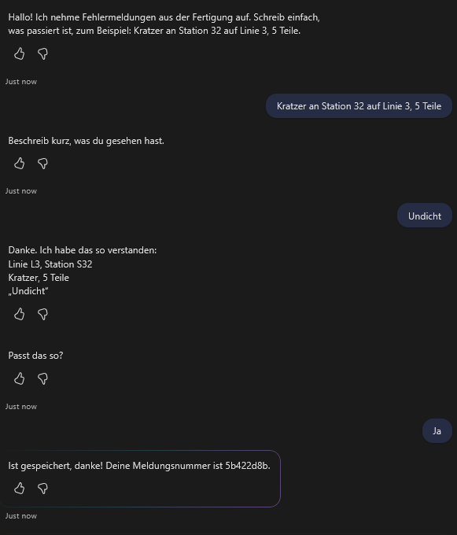
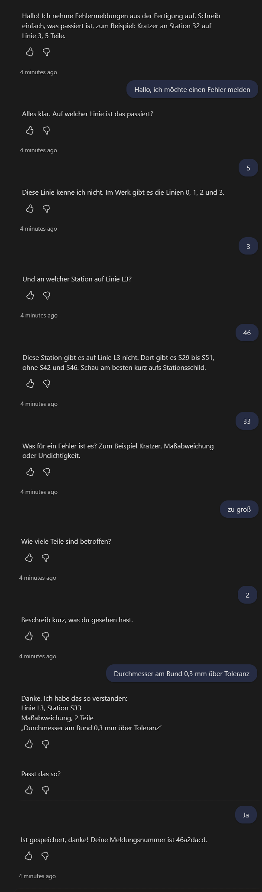
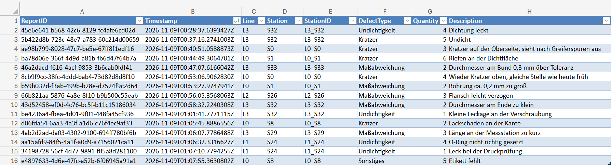
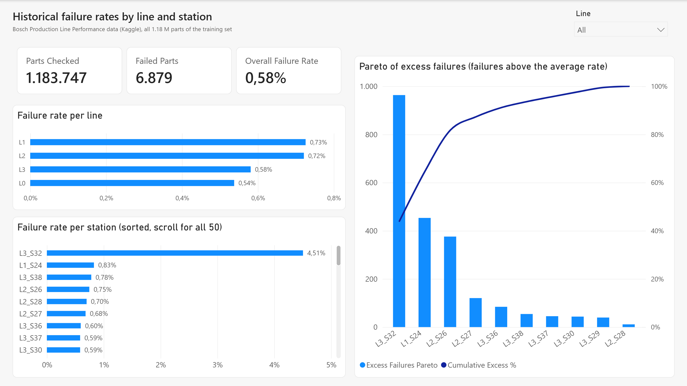
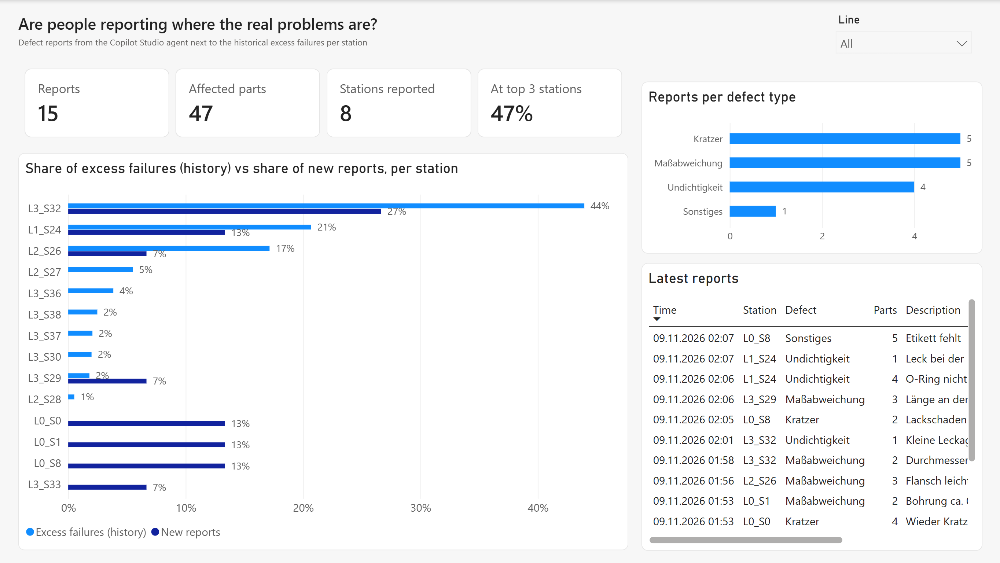
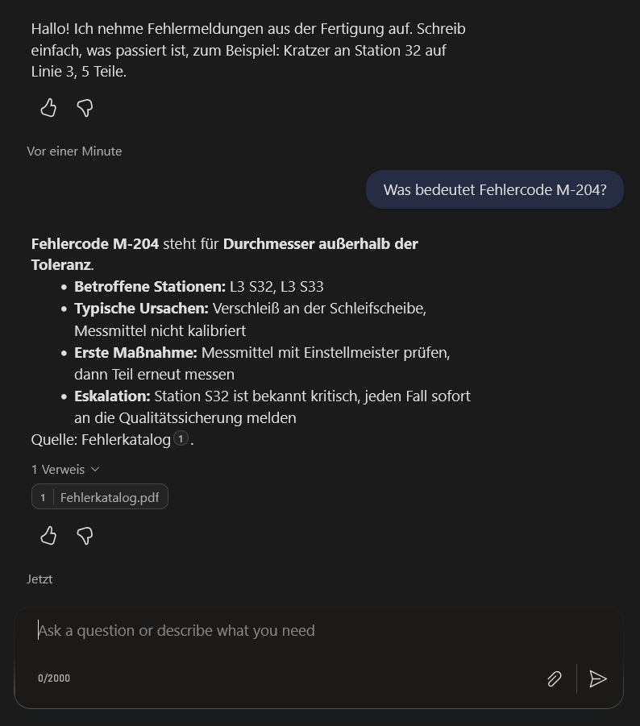
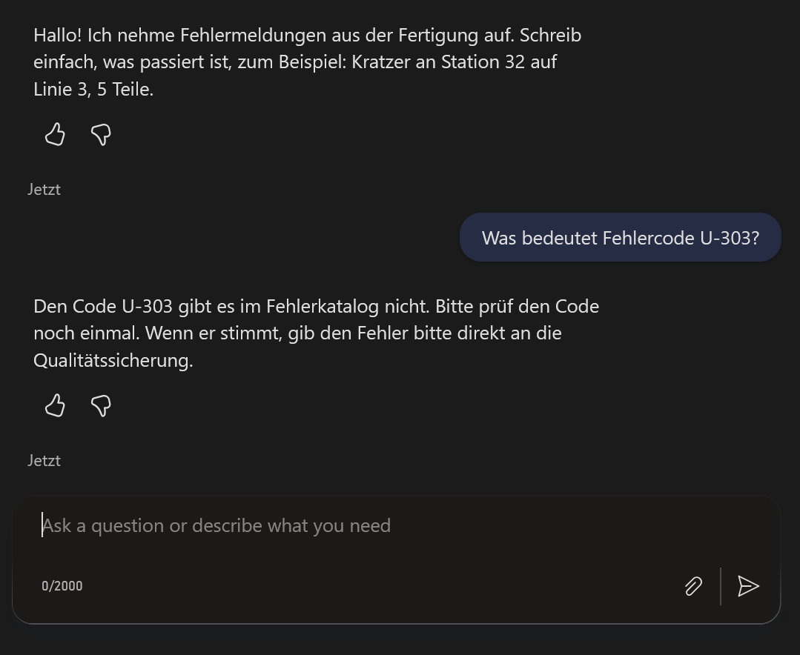

# QM-Fehlermeldeassistent

A chat assistant for defect reports on the shop floor, built with the Microsoft Power Platform. A worker describes a defect in their own words in German. The agent asks for the details it still needs, checks that the line and station really exist, and saves the confirmed report to an Excel table on OneDrive. It can also explain defect codes from a defect catalogue. A Power BI report then compares these reports with historical failure rates from Bosch production data.

## How it works

1. **Data preparation in Python.** The script prepare_data.py reads the Bosch Production Line Performance data from Kaggle (about 1.2 million parts) and works out how often parts fail at each line and station. The column names in the data tell which station measured a part, so every part can be traced through the plant.
2. **Copilot Studio agent.** One topic collects line, station, type of defect, number of parts and a short description. Before saving, the agent shows a summary and asks the worker to confirm it. A second topic explains defect codes from the catalogue.
3. **Power Automate flow.** The agent calls a flow that adds the report with an ID and a timestamp as a new row to an Excel table on OneDrive. The ID goes back to the worker as a reference number.
4. **Power Apps solution.** Agent, flow and the Excel connection are packaged in one Power Platform solution, which can be imported into another environment.
5. **Power BI report.** The first page shows the historical failure rates, the second page puts the new reports next to them.

## Screenshots

The worker can say everything in one sentence, and the agent only asks for what is missing.

A report step by step. Line 5 and station 46 do not exist, so the agent asks again.

Every confirmed report ends up as a row in Excel.

## The Power BI report

The first page answers the question where parts fail most often. Next to the failure rate per line and per station there is a Pareto chart, which helps in quality management because it shows at a glance which few stations are behind most of the problems. The bars show the stations sorted from worst to best and the line shows how much of the total the stations add up to.

The second page answers a different question. Do people report defects where the real problems are, or only where defects are easy to see? For every station it shows two bars next to each other, its share of the historical failures and its share of the new reports. If both bars are about the same length, reporting works. If a station has a long history bar and a short report bar, problems there probably go unnoticed.

## How the agent avoids invalid stations

The Bosch data has 50 stations, and every station belongs to exactly one line. The agent checks this with fixed rules.

- Line and station are asked as numbers and checked against the stations that exist in the data. If the number is wrong, the agent lists the valid stations of that line.
- If the first message already contains line, station or number of parts, the agent reads them out and runs the same check on them. Station 42 on line 3 is rejected with a hint.
- The type of defect comes from a fixed list with synonyms, so "undicht" counts as Undichtigkeit and "zu groß" counts as Maßabweichung.
- Nothing is saved before the worker confirms the summary. If they answer no, the agent starts over.

## RAG for codes from a PDF

Workers can ask the agent what a defect code means and the agent answers from a catalogue in PDF form that is added to Copilot Studio as a knowledge source.

Codes that are not in the catalogue are rejected before the model is asked, so it cannot invent an answer.

## Repository

| Folder | Content |
|---|---|
| prepare_data.py | data preparation |
| data | aggregated results, no raw Kaggle data |
| copilot-studio | the topics, the agent instructions and the flow definition |
| knowledge | example defect catalogue used as knowledge source |
| solution | Power Platform solution export |
| powerbi | Power BI project, open qm_report.pbip in Power BI Desktop |
| excel | empty template for the report table |
| docs | design notes and the test protocol for the knowledge source |
